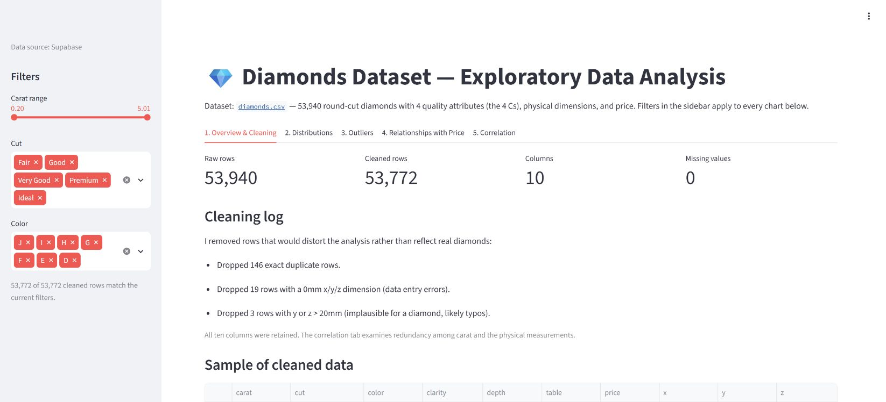
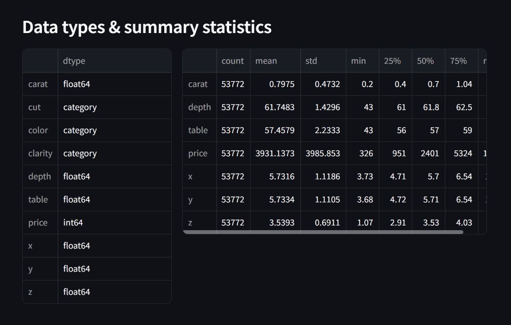
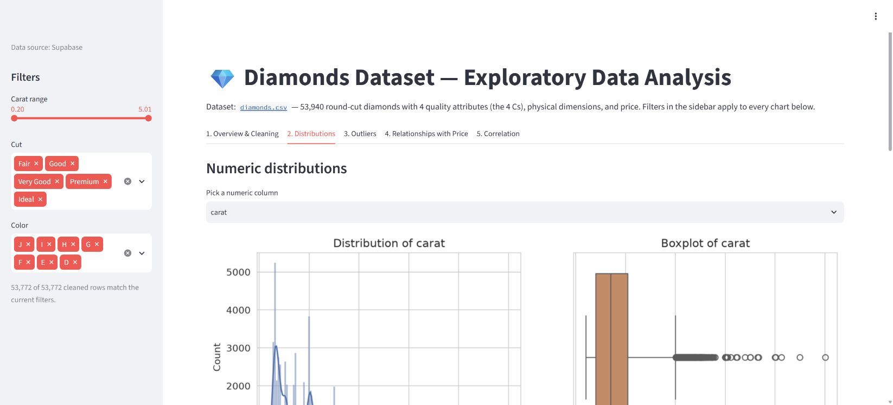
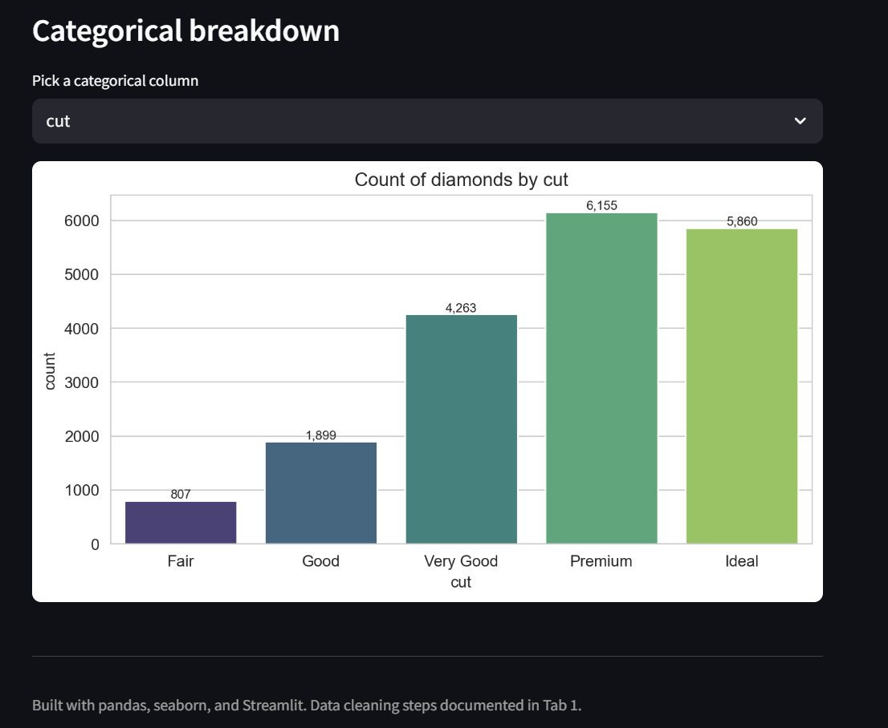
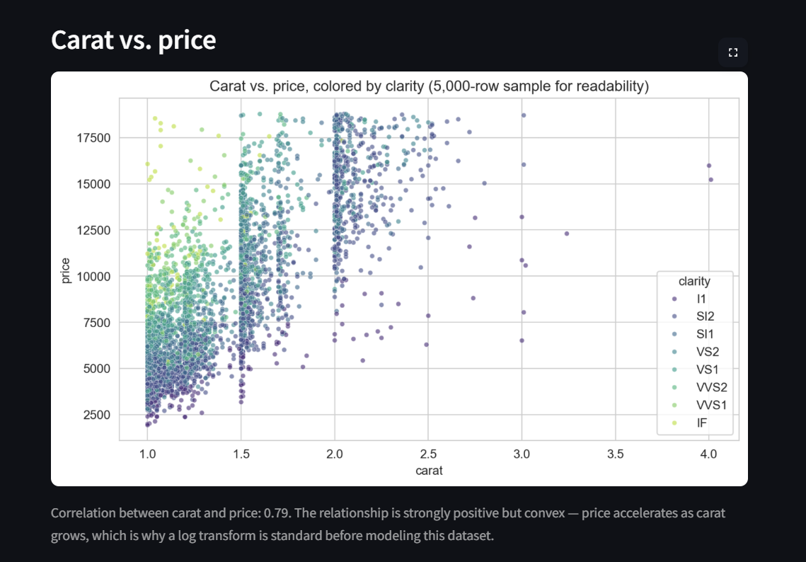
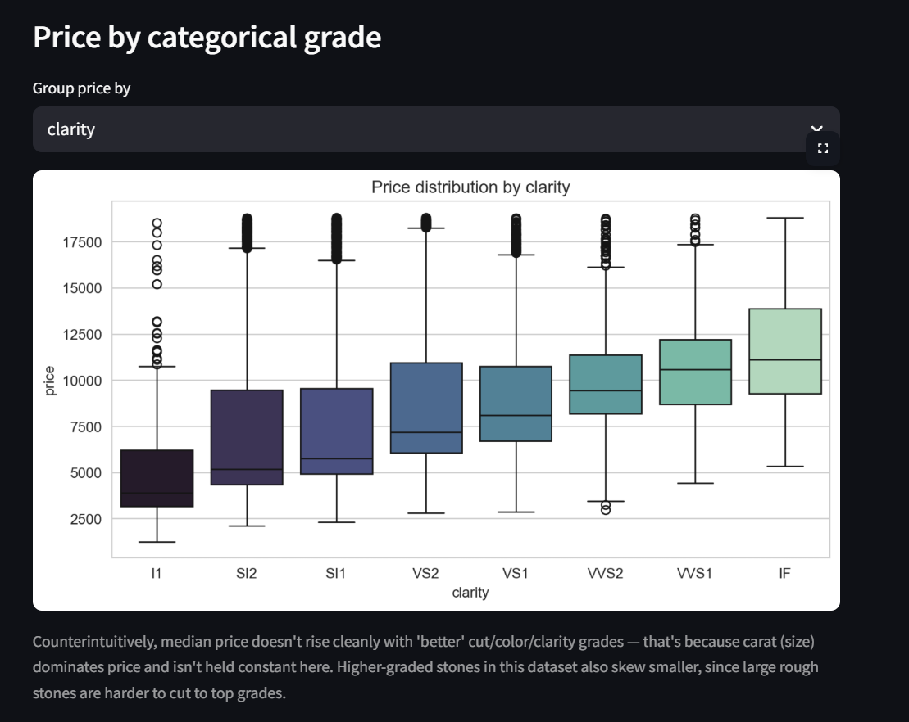

# Diamonds Dataset — EDA Streamlit App

A Streamlit app that loads the `diamonds.csv` dataset (53,940 round-cut
diamonds), cleans it, and walks through a full exploratory data analysis:
structure, distributions, outliers, and relationships with price.

**[Open the live application →](https://juanthom99--diamonds-eda-app-run.modal.run/)**

## Hosting and data

The finished app is hosted on **Modal** and reads the public diamonds table from **Supabase** using the existing server-side `supabase-secret`. Reads are paginated to include the full dataset. The sidebar identifies the active source. If Supabase is temporarily unavailable, the packaged CSV keeps the demo usable; a fallback is identified explicitly rather than presented as a successful database connection.

For local development, copy `.env.example` to `.env` and set your Supabase connection values. Do not commit credentials. With no connection configured, the app uses the bundled CSV.

Deploy with `python -m modal deploy serve_streamlit.py` after configuring the server-side secret in your Modal workspace. The deployment includes the application, data loader, and CSV fallback.

## Dataset

`data/diamonds.csv` — 10 columns: `carat`, `cut`, `color`, `clarity`, `depth`,
`table`, `price`, `x`, `y`, `z`. Source: the standard seaborn example dataset
(originally from ggplot2).

## Setup

```bash
# from inside this folder
uv sync
uv run streamlit run app.py
```

(Or with plain pip: `pip install -r requirements.txt` then
`streamlit run app.py`.)

The app opens at `http://localhost:8501`.

## What's in the app

- **Tab 1 — Overview & Cleaning**: shape, dtypes, missing-value check, and
  the cleaning steps applied (146 exact duplicates dropped, 20 rows with a
  0mm dimension dropped, a few rows with implausible 20mm+ dimensions
  dropped as likely data-entry typos). No columns were dropped; correlations and redundant dimensions are examined
  explicitly in the correlation tab.
- **Tab 2 — Distributions**: histogram + boxplot for any numeric column,
  skewness callout, and count plots for the three categorical grades
  (cut, color, clarity).
- **Tab 3 — Outliers**: IQR-based outlier table across all numeric columns,
  plus a carat-vs-price scatterplot with price outliers highlighted (kept
  in the data — they're real large/high-clarity stones, not errors).
- **Tab 4 — Relationships with Price**: carat vs. price colored by clarity,
  and price distribution by cut/color/clarity.
- **Tab 5 — Correlation**: heatmap across numeric features, with a note on
  the near-collinearity of carat/x/y/z.

All charts respond to the carat/cut/color filters in the sidebar.

## Screenshots








## Notes

- Data cleaning removes duplicates and physically impossible measurements
  (e.g. a diamond with 0mm depth) rather than silently reindexing — the
  cleaning log is shown in the app itself, not just in this README.
- The 4 Cs (carat, cut, color, clarity) are treated as ordered categorical
  variables so plots and comparisons respect their natural grade order.
